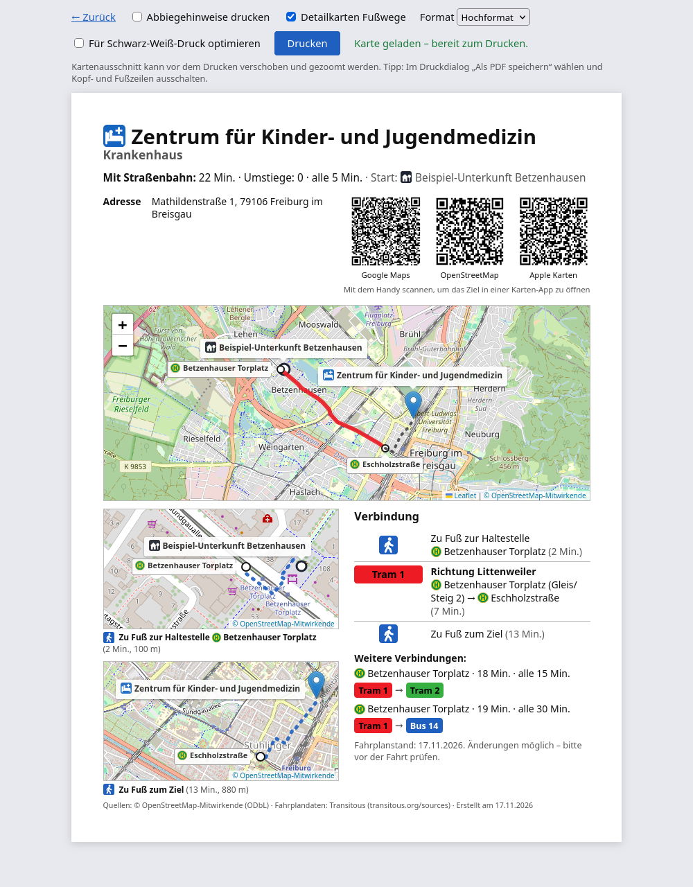
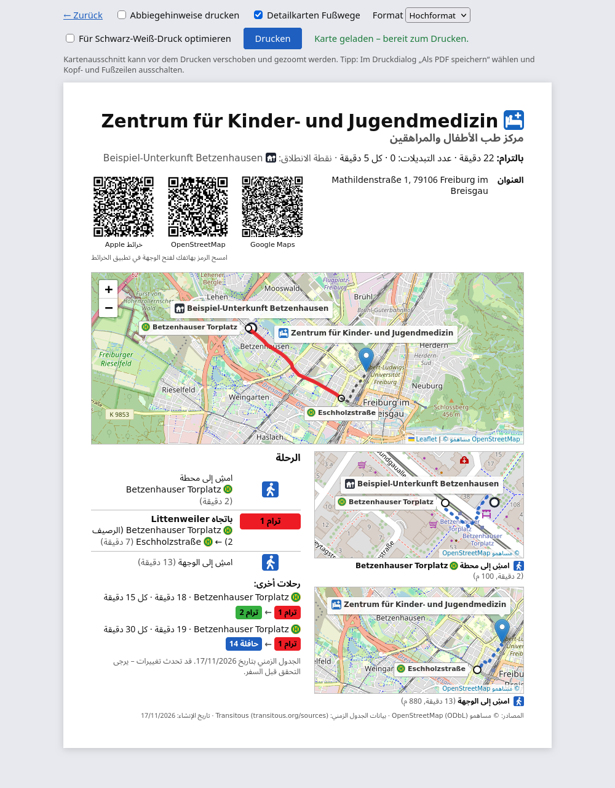
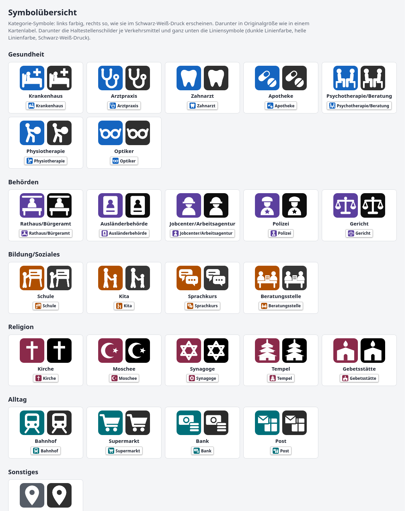
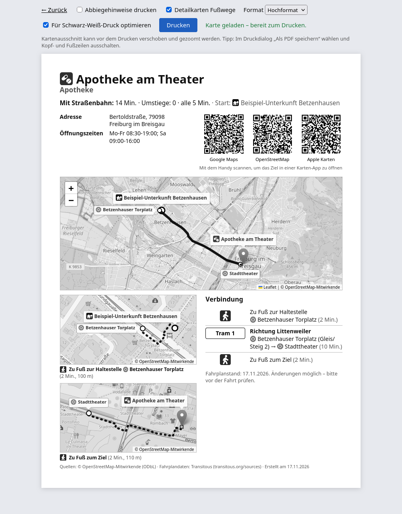
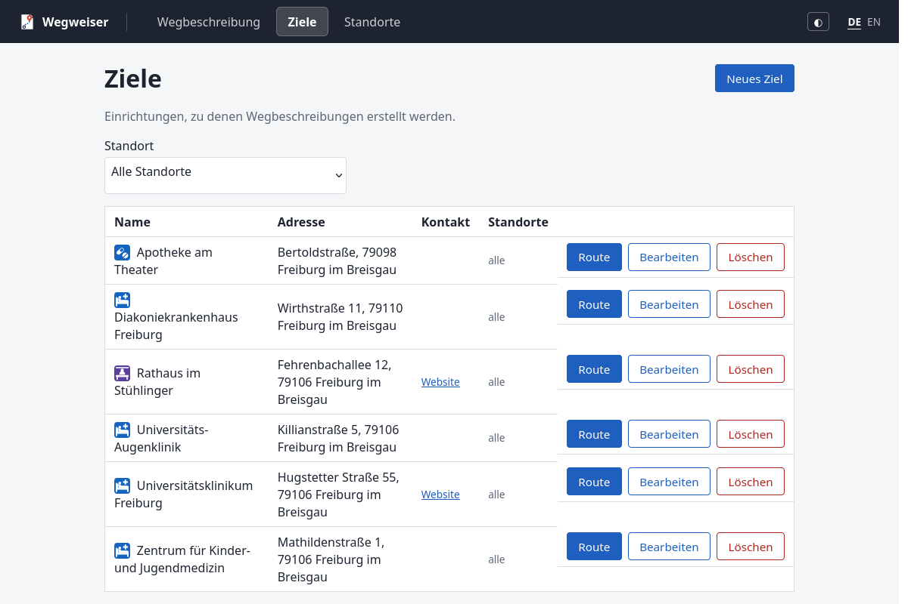

# Wegweiser

Wegweiser erstellt **druckfertige Wegbeschreibungen auf A4**: von festen Standorten, zum Beispiel einer Unterkunft für Geflüchtete, zu Krankenhäusern, Arztpraxen, Apotheken oder Behörden in der Umgebung. Der Ausdruck ist für Menschen gedacht, die die Stadt und oft auch die Sprache noch nicht kennen. Er zeigt den Weg auf einer Karte, die Verbindung mit Bus und Bahn, und er lässt sich in viele Sprachen umstellen.

Das Werkzeug ersetzt einen mühsamen Ablauf: Google-Maps-Druckansicht, Screenshot in eine Word-Vorlage, Überschrift anpassen, QR-Code einfügen. Es läuft selbst gehostet im eigenen Netz, ohne Konto und ohne Tracking.



*Alle Screenshots zeigen Beispieldaten aus Freiburg im Breisgau. Die „Beispiel-Unterkunft“ ist ein frei gewählter Startpunkt.*

## Was der Ausdruck enthält

- **Ziel als Überschrift**, darunter die Art der Einrichtung oder ein übersetzter Name in der gewählten Sprache
- **Karte** mit Route, Start, Ziel und Haltestellen; bei ÖPNV zusätzlich **Detailkarten der Fußwege** zur ersten und von der letzten Haltestelle, so nah wie möglich herangezoomt
- **ÖPNV-Verbindung**: Fußweg, Linie mit Linienfarbe und Fahrtrichtung, Ein- und Ausstieg, Dauer, Takt („alle 15 Min.“) statt fester Abfahrtszeiten, dazu weitere Verbindungen
- **Adresse, Telefon, Website und Öffnungszeiten** des Ziels
- **QR-Codes** für Google Maps, OpenStreetMap und Apple Karten, damit jede Person ihre eigene Karten-App nutzen kann
- **Quellenangaben und Erstellungsdatum**, mit dem Hinweis, dass sich Fahrpläne ändern können

Ausgegeben wird über die Druckfunktion des Browsers („Als PDF speichern“). Die Druckansicht wartet, bis alle Kartenkacheln geladen sind. Hoch- und Querformat sowie eine Schwarz-Weiß-Variante sind wählbar.

## Verständlich über Sprachgrenzen hinweg

Die Sprache der Wegbeschreibung ist pro Ausdruck wählbar, darunter Arabisch, Persisch, Türkisch, Ukrainisch, Russisch, Tigrinya und Somali (insgesamt 28 Sprachen). Rechts-nach-links-Sprachen werden richtig gesetzt. Deutsche Namen von Haltestellen und Einrichtungen bleiben stehen, damit man sie auf den Schildern vor Ort wiederfindet.



- **Abbiegehinweise** kommen von openrouteservice in dessen Sprachen, für weitere Sprachen erzeugt das Werkzeug sie aus eigenen Vorlagen.
- **Namen der Ziele**: Unter einem Eigennamen wie „Fielmann“ steht die Art der Einrichtung („Optiker“) in der gewählten Sprache. Übersetzbare Namen wie „Kinderklinik“ lassen sich pro Sprache hinterlegen, Vorschläge kommen aus OpenStreetMap.
- **Prüfseite** „Übersetzungen prüfen“: alle Texte einer Sprache auf einer Seite, zum Gegenlesen durch Muttersprachlerinnen und Muttersprachler.
- **Haltestellennamen** werden gekürzt, wenn Start und Ziel im selben Ort liegen („Paduaallee“ statt „Freiburg, Paduaallee“), wie auf den Anzeigen in Bus und Bahn.

## Symbole mit hohem Kontrast

Alle Symbole sind eigene, einfache Zeichnungen mit starkem Kontrast, auch für Menschen mit eingeschränktem Sehvermögen und im Schwarz-Weiß-Druck gut erkennbar.

- **Kategorie-Symbole** für Ziele zeigen konkrete Dinge statt Sinnbilder (Zahn, Brille, Stethoskop), ohne Buchstaben. Gestaltet wurden sie nach Erkenntnissen aus der Forschung zu kulturübergreifend verständlichen Piktogrammen. Die Farbe steht für die Gruppe: Gesundheit, Behörden, Bildung/Soziales, Religion, Alltag.
- **Haltestellenschilder** je Verkehrsmittel: H für Bus und Straßenbahn, eigene Schilder für Bahn, U-Bahn, Fähre und Seilbahn.
- **Liniensymbole** für Verkehrsbetriebe, deren Linien Bildzeichen tragen (zurzeit TüBus Tübingen). Sie stehen hinter der Liniennummer in deren Schriftfarbe, wie auf den Bussen.



Die vollständige Übersicht liegt in der laufenden App unter `/static/symbol-preview.html`.



## Ziele und Standorte verwalten

Standorte (Startpunkte) und Ziele werden einmal angelegt und stehen danach per Auswahlliste bereit. Ein neues Ziel sucht man über Name oder Adresse in OpenStreetMap; Adresse, Koordinaten, Telefon, Website, Öffnungszeiten, Kategorie und übersetzte Namen werden vorbefüllt und lassen sich korrigieren. Ziele können einzelnen Standorten zugeordnet werden.



## Datenquellen

Alle externen Dienste werden nur vom Server aus aufgerufen, gedrosselt und in SQLite zwischengespeichert. API-Schlüssel bleiben auf dem Server. An die Dienste gehen nur Adressen und Koordinaten, keine personenbezogenen Daten.

| Zweck | Quelle | Hinweise |
|---|---|---|
| Suche (Geocoding) | [Nominatim](https://nominatim.org/) (OpenStreetMap) | max. 1 Anfrage/s, [Nutzungsrichtlinie](https://operations.osmfoundation.org/policies/nominatim/) |
| Auto- und Fußrouten, Abbiegehinweise | [openrouteservice](https://openrouteservice.org/) (HeiGIT) | API-Schlüssel nötig; Tageszähler stoppt bei `ORS_DAILY_LIMIT` |
| Bus und Bahn | [Transitous](https://transitous.org/) (MOTIS 2) | nur nicht-kommerziell, Kontakt im User-Agent; Tageszähler stoppt bei `TRANSITOUS_DAILY_LIMIT` ([Nutzungsrichtlinie](https://transitous.org/api/)) |
| Kartenkacheln | tile.openstreetmap.org | lädt der Browser bei Bedarf, kein Vorab-Download; Quellenangabe auf Karte und Ausdruck |

QR-Codes werden lokal erzeugt. Leaflet 1.9.4 und die Noto-Schriften liegen unter `app/static/vendor/` (Lizenzen dort).

## Betrieb und Nutzungsbedingungen

Wegweiser ist Software zum Selbstbetrieb. Es gibt keinen zentralen Dienst: Jede Organisation betreibt ihre eigene Instanz und ist selbst dafür verantwortlich, die Bedingungen der genutzten Dienste einzuhalten. Die Voreinstellungen zielen auf kleine, nicht-kommerzielle Instanzen, etwa eines Vereins oder einer Initiative in der Flüchtlingshilfe.

**Öffentliche Dienste und ihre Grenzen** (Stand November 2026, bitte vor dem Betrieb selbst prüfen):

- **Transitous** ist ein gemeinschaftlich betriebener Dienst für nicht-kommerzielle Nutzung und Open-Source-Projekte. Pro Instanz eine eigene Kontaktangabe in `APP_CONTACT` eintragen. Mehr als 720 Verbindungsanfragen am Tag nur nach Absprache.
- **openrouteservice**: Der kostenlose Standard-Plan von HeiGIT hat Tageslimits und ist nicht für kommerzielle Nutzung gedacht. Jede Instanz braucht einen eigenen API-Schlüssel.
- **Nominatim** (OpenStreetMap-Foundation): höchstens eine Anfrage pro Sekunde, keine Massenabfragen. Wegweiser sucht nur, wenn jemand ein Ziel anlegt, und speichert die Ergebnisse zwischen.
- **Kartenkacheln** von tile.openstreetmap.org: Es gilt die [Tile Usage Policy](https://operations.osmfoundation.org/policies/tiles/). Die Quellenangabe muss sichtbar bleiben, auch auf dem Ausdruck.

**Kommerzielle oder größere Nutzung**, zum Beispiel durch ein Unternehmen, das im Auftrag von Behörden Unterkünfte betreibt: Die öffentlichen Dienste sind dafür nicht gedacht. Möglich ist dann:

- ÖPNV über einen selbst betriebenen [MOTIS](https://github.com/motis-project/motis)-Server mit offenen Fahrplandaten, etwa GTFS der NVBW für Baden-Württemberg oder DELFI für Deutschland. `TRANSITOUS_BASE_URL` zeigt dann auf diesen Server.
- Routen über ein selbst betriebenes [openrouteservice](https://github.com/GIScience/openrouteservice) (`ORS_BASE_URL`) oder einen kommerziellen Plan bei HeiGIT.
- Kartenkacheln von einem kommerziellen Anbieter oder einem eigenen Kachelserver.

Zurzeit gibt es dabei zwei Einschränkungen: Die Kachel-URL ist noch fest eingetragen, und ohne `ORS_API_KEY` werden keine Routen berechnet, auch nicht bei einem eigenen Server.

**Datenschutz:**

- An die externen Dienste gehen nur Adressen und Koordinaten von Standorten und Zielen. Namen oder andere Angaben zu Bewohnerinnen und Bewohnern gehören nicht in Wegweiser, auch nicht in die Notizfelder.
- Adressen von Unterkünften sind schutzbedürftig. Die Instanz soll deshalb nur im internen Netz oder per VPN erreichbar sein.
- Wer Fehler meldet oder Screenshots teilt, nimmt Beispieldaten statt echter Standorte.

**Sicherung:** Alle Daten stehen in einer einzigen Datei, `./data/wegweiser.sqlite`. Eine konsistente Kopie im laufenden Betrieb erstellt `sqlite3 data/wegweiser.sqlite ".backup sicherung.sqlite"`. Die Kopie kann man auf einem zweiten Datenträger oder in einem Cloud-Speicher ablegen.

**Haftung:** Routen, Fahrpläne und Öffnungszeiten stammen aus offenen Datenquellen und können falsch oder veraltet sein. Den Ausdruck vor der Weitergabe kurz prüfen.

## Installation mit Docker

```sh
cp .env.example .env   # ORS_API_KEY und APP_CONTACT eintragen, ggf. APP_PORT anpassen
docker compose up -d --build
```

Die Oberfläche ist danach unter `http://<host>:${APP_PORT:-8420}/` erreichbar. Gedacht ist der Betrieb im internen Netz oder per VPN, nicht öffentlich im Internet.

- Die SQLite-Datenbank liegt unter `./data/` (Volume). Der Container läuft als UID 1000 und macht `./data` beim Start für sich beschreibbar.
- Die Zeitzone für Datumsangaben auf dem Ausdruck ist `Europe/Berlin` (über `TZ` änderbar).
- Nach Änderungen an `.env` den Container neu erzeugen: `docker compose up -d`.

## Entwicklung

```sh
python3 -m venv .venv
.venv/bin/pip install -r requirements-dev.txt
.venv/bin/uvicorn app.main:app --reload --port 8420
.venv/bin/pytest
```

Python 3.12, FastAPI, Jinja2, SQLite, Vanilla JS und Leaflet, ohne Build-Schritt. Die Tests rufen keine externen Dienste auf. Texte der Oberfläche (Deutsch und Englisch) stehen in `app/i18n.py`, Texte des Ausdrucks ebenfalls dort, Kategorienamen in `app/category_names.py`. Projektregeln und Hintergründe stehen in `CLAUDE.md`.

## Lizenz

Wegweiser steht unter der [Europäischen Gemeinschaftslizenz EUPL 1.2](LICENSE). © 2026 Moritz Werner. Mitgelieferte Fremdkomponenten (Leaflet, Noto-Schriften) haben eigene Lizenzen, siehe `app/static/vendor/`. Die Kategorie- und Liniensymbole sind eigene Zeichnungen und stehen ebenfalls unter der EUPL.
